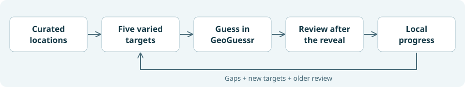

# Fieldwork

[](https://github.com/sethmorton/fieldwork/actions/workflows/ci.yml)

**GeoGuessr practice that remembers what you miss—and gives you room to learn something else.**

Fieldwork turns a curated pool of real locations into adaptive five-round maps. Guess normally, review the visual clue after the reveal, and keep going. Your next set aims for three new targets and two reviews, across five different clue families.

Australia, the Philippines and Worldwide are supplied packs. One small userscript keeps separate maps and progress for each; content packs download separately and stay cached.



> **Working prototype.** The Australian pack has 74 active regional targets across 19 families. The Philippines pack adds 166 active regional targets across 15 families and 922 practice panoramas. The Worldwide pack adds 535 targets across 13 families and 8,120 practice panoramas, including 185 of the official Intermediate collection’s 190 clues. These are partial teaching pools, not complete curricula or validated measures of mastery.

## Set it up with an agent

Give a coding agent this repository and paste:

> Read AGENTS.md and docs/SETUP.md. Help me set up Fieldwork in my own Chrome profile and on a separate GeoGuessr map I own. Install dependencies, run the checks, fetch the public source notes, and build my configured userscript. Guide me through any browser installation steps you cannot perform. Keep my credentials and progress local. Verify the practice panel and leave the first round ready without guessing for me.

The agent can handle the terminal work. You still need a GeoGuessr account with map-making access and a browser userscript manager.

## Quickstart

Requires **Node.js 24.12+**, npm, Chrome/Chromium and [Tampermonkey](https://www.tampermonkey.net/). Follow the [userscript setup guide](https://learnablemeta.com/docs/getting-started/chrome) for Chrome's userscript permission.

1. In [GeoGuessr Map Maker](https://www.geoguessr.com/map-maker), create and save a **separate map you own**, named `Fieldwork - Practice`. Keep the map-maker URL. This map's five locations will be replaced during practice.
2. Clone and prepare:

   ```sh
   git clone https://github.com/sethmorton/fieldwork.git
   cd fieldwork
   npm ci
   npm run check
   npm run content:refresh
   npm run setup -- --map YOUR_24_CHARACTER_MAP_ID --pack local/pack.json
   npm run serve
   ```

3. Open **http://127.0.0.1:8787**, install the generated userscript, and follow its link to your map in a **fresh Chrome tab**.
4. Click **Continue practice** in the Fieldwork panel. It publishes five locations and starts the game. Bookmark your own map URL for future sessions.

You can stop the local server after installation and the first pack has loaded. Everyday practice runs in GeoGuessr; it does not need this repository or a server running. See [setup and troubleshooting](docs/SETUP.md) if the panel does not appear.

The supplied packs receive background content updates without reinstalling the
script. Cached content survives a content-host outage; your progress stays local.
Engine updates preserve existing history and in-flight games.

## What practice does

- **Five different clue families per set.** Related subtypes cannot fill all five slots.
- **Space retries.** Previous-set targets rest for one set when enough alternatives exist, including after a miss. Prefer unfamiliar panoramas.
- **Review after guessing.** Upcoming targets stay hidden. The result shows the source image, explanation and attribution.
- **Low-friction feedback.** Moving on means “assumed spotted.” Press **Missed it** when needed; explicit feedback wins.
- **Keep progress local.** Reviews and exposure history live in Tampermonkey's storage. Export them under **Content & progress**.
- **See your progress tree.** Expand **Content & progress** on the practice map, or **Your progress tree** after a guess. Each pack branches into clue families and individual targets; practice, mastery and review needs stay distinct.

Country-only practice excludes clues that merely identify the country. It focuses on differences *within* the country. A correct state guess alone does not prove clue recognition, and assumed feedback never counts as verified mastery.

## Bring your own content

Use a distinct pack ID and dedicated practice map for each country/topic. Packs define clue families, priorities, real panorama locations, source attribution and optional regional boundaries. A slide deck or guide helps define targets; it does not magically provide playable, correctly tagged locations.

To add the Philippines or Worldwide alongside Australia, see [multiple-pack setup](docs/SETUP.md#add-the-philippines-or-another-pack).

The [content guide](docs/CONTENT.md) covers native Map Maker exports, Learnable Meta imports, curation and activation checks. The Australian source inventory is included to show coverage and gaps; its 178 source units are **not** 178 available learning tasks.

## Develop

```sh
npm ci
npm run check
npm run build  # after local setup
```

| Path | Purpose |
| --- | --- |
| `src/lib/adaptive.ts` | Location selection and spacing |
| `src/lib/mastery.ts` | Conservative evidence and review status |
| `src/lib/fsrs.ts` | FSRS-6 review scheduling, replayed from attempts |
| `src/browser.mjs`, `session.mjs`, `ui.mjs` | Browser integration, publication and post-guess feedback |
| `src/tests/`, `scripts/*.test.mjs` | Automated checks with synthetic learner observations |
| `content/australia.json`, `content/philippines.json`, `content/worldwide.json` | Unbound country packs; no personal practice-map binding |
| `scripts/` | Local setup, build, source-note refresh and installer server |
| `fixtures/` | Isolated browser checks; never connected to a real account |

The script reads completed rounds and replaces/publishes only the configured dedicated map, after saving a draft backup. GeoGuessr's map-writing endpoints are unofficial and may change. See [architecture and limitations](docs/ARCHITECTURE.md).

## Credits, status and help

Built by [Seth Morton](https://github.com/sethmorton). Report reproducible bugs or propose a content pack in [Issues](https://github.com/sethmorton/fieldwork/issues). Do not include credentials, progress exports or private account data.

Content is informed by [Learnable Meta](https://learnablemeta.com/), [Plonk It Australia](https://www.plonkit.net/australia) and the [Australia reference deck](https://docs.google.com/presentation/d/1ZXxLem3YRLWw_tmP6v31VrkiqMvcoE1GXWbTN7Pi0Ds/edit). Browser events use [GeoGuessr Event Framework](https://github.com/miraclewhips/geoguessr-event-framework), pinned to a commit. Fieldwork is unaffiliated with these projects or GeoGuessr.

Original Fieldwork code is MIT licensed. Third-party notes, images, reference material and geographic data retain their original rights and attribution; see [THIRD_PARTY.md](THIRD_PARTY.md). Full Learnable Meta explanation text is fetched locally during setup or after a guess, rather than republished with public content assets.
