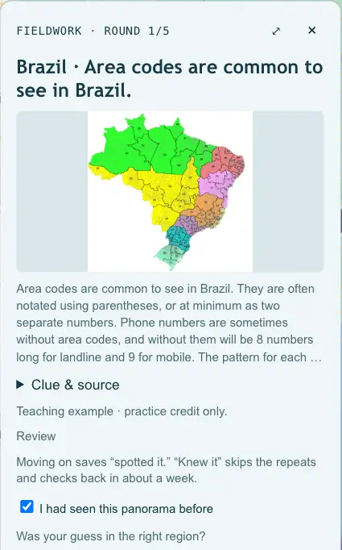
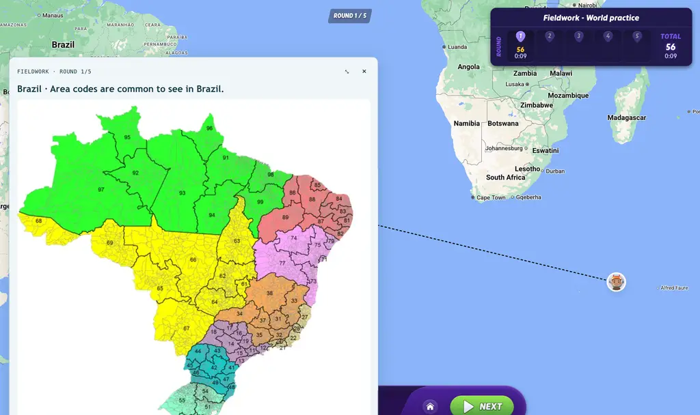
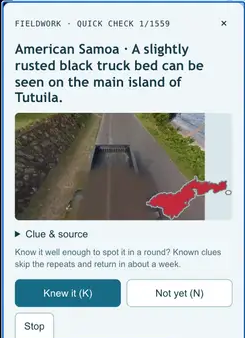

# Fieldwork

**Spaced-repetition practice for GeoGuessr, built on your own map and the Plonk It guide.**

Fieldwork is a Tampermonkey userscript. It turns a GeoGuessr map you own into a practice map: every set of five rounds is picked for you, and after each guess a clue card shows the Plonk It note and image for what you were meant to spot. You say whether you missed it, spotted it or already knew it, and Fieldwork decides when that clue comes back.



## What you get

- **The World pack.** About 2,150 Plonk It clues across 118 countries, each with two or three real Street View locations. New clues come landscape and utility poles first, then in order of how often a small vision model sees them on about 1,270 rounds shaped like A Competitive World, the ranked No Move map. Practice locations prefer rural scenes like the ranked map, except for phone-number and sign clues.
- **A clue card after every guess.** The Plonk It text and image, a link to the guide page, and three buttons: **Missed it**, **Spotted it**, **Knew it**.
- **Quick check.** Flip through clue cards without playing rounds and clear the ones you already know.
- **Sprint drill card.** Sprint packs show a lean card: the tell, what missing it cost you, the example image (click for full screen, Esc closes) and the area you confused it with. Press **1** Missed, **2** Spotted, **3** Knew it; after round 5, **C** or **Enter** continues. Round 5 lists the set's five cards, misses first. A muted line tracks today's rounds, the current block (take 5 minutes after 25) and retired clues.
- **An expandable card.** Press ⤢ (or click the image) to see the image full size over the map. Fieldwork remembers your choice.
- **FSRS spacing.** Reviews are scheduled with FSRS-6, the algorithm Anki uses. Clues you miss come back soon. Clues you know come back later and later.
- **Local only.** Your progress lives in your browser. There is no Fieldwork account or server.



## Install

You need a GeoGuessr account that can create maps (Map Maker) and a desktop browser.

1. **Install [Tampermonkey](https://www.tampermonkey.net/).** In Chrome and other Chromium browsers, also turn on **Allow User Scripts** for Tampermonkey ([Learnable Meta's guide](https://learnablemeta.com/docs/getting-started/chrome) walks through it). If you already run the Learnable Meta script, you are set.
2. **Install Fieldwork:** open <https://sethmorton.github.io/fieldwork/fieldwork.user.js> and confirm in Tampermonkey.
3. **Make a practice map and bind it.** In [Map Maker](https://www.geoguessr.com/map-maker), create a new map whose name starts with `Fieldwork` (for example `Fieldwork - World practice`), add any location and save. Open a fresh tab on that map's Map Maker page. The panel asks **Use this map for practice?** Pick the pack this map is for, then press **Continue practice**.

Fieldwork replaces the map's locations with each new set, so never use a map you want to keep. Bookmark `https://www.geoguessr.com/maps/<your map ID>` and press **Continue practice** there next time. Want a second pack? Make a second `Fieldwork` map and bind it to that pack.

If the panel does not appear: check that the script is enabled, that the map name starts with `Fieldwork`, that you are signed in as its owner, and open a new tab. More in [setup and troubleshooting](docs/SETUP.md#troubleshooting).

## How a session works

1. **Continue practice** writes five locations to your map, publishes it and starts the game.
2. Play each round normally. Nothing about the target clue is shown before you guess.
3. After the guess, the clue card appears. Answer honestly:
   - **Missed it**: you did not notice or did not know the clue. It comes back within minutes.
   - **Spotted it**: you saw it and used it. Moving on without pressing anything also counts as spotted.
   - **Knew it**: this was already easy for you. It skips the short repeats. A new clue returns in about a week. One you have practised keeps a longer interval.
4. After round five, **Continue practice** builds the next set.

Each set mixes due reviews with new clues, and holds at most two clues from the same family, so you never get five phone-code rounds in a row. How many new clues you get depends on how well your recent rounds went.

**Quick check** sits next to Continue practice on the start panel. It shows one card at a time from clues that are new or still in their short repeats. Press **K** for knew it or **N** for not yet. New clues you mark known come back about a week later in a real round to confirm.



**What FSRS does, in plain words.** Every answer updates an estimate of how well you remember each clue. Fieldwork brings a clue back around the time you would start to forget it. A clue you keep spotting returns after a couple of days, then about a week and a half, then over a month. A clue marked **Knew it** returns in about a week, then about a month later. A miss starts it over.

Open **Content & progress** on the start panel (or **Your progress tree** on a card) to see every clue family and where you stand.

## Packs

| Pack | What it covers |
| --- | --- |
| World PlonkIt clue bank | About 2,150 Plonk It region-guessing clues, landscape and poles first, rural locations preferred, 2-3 locations each |
| World foundations & intermediate | Bollards, pedestrian signs, languages, poles, chevrons, plates, Brazilian phone codes and more |
| Australia region practice | State-level clues within Australia |
| Philippines region practice | Regional clues within the Philippines |

Packs update in the background without reinstalling the script. Each pack needs its own bound map.

## Privacy

- Progress, history and map bindings are stored in Tampermonkey's script storage. Downloaded packs are cached in your browser's IndexedDB. Nothing is uploaded. Export a backup under **Content & progress**.
- The script works through your signed-in GeoGuessr page. There is no Fieldwork account, and it never exports cookies or tokens.
- Besides GeoGuessr, the script contacts `sethmorton.github.io` (pack downloads) and `learnablemeta.com` (clue explanations for the older packs). Card images load from `www.plonkit.net`, `learnablemeta.com` and, for two Australia clues, `geohints.com`. Tampermonkey fetches the GeoGuessr Event Framework from `raw.githubusercontent.com`.
- Fieldwork only edits the map you bound, and backs up its draft before each set. GeoGuessr's map-editing API is unofficial and may change.

## Credits and licence

- **[Plonk It](https://www.plonkit.net/)** wrote the guide. Clue text and images are used under [CC BY-NC-SA 4.0](https://creativecommons.org/licenses/by-nc-sa/4.0/) and every card credits the guide page it came from.
- **[Learnable Meta](https://learnablemeta.com/)** and its community map makers. Many practice locations come from their public maps.
- **[GeoGuessr Event Framework](https://github.com/miraclewhips/geoguessr-event-framework)** by miraclewhips tells Fieldwork when a round ends.
- **[FSRS](https://github.com/open-spaced-repetition)** by open-spaced-repetition. Fieldwork implements FSRS-6 with its default parameters.

Fieldwork is not affiliated with GeoGuessr, Plonk It or Learnable Meta.

The Fieldwork code is [MIT](LICENSE). The World pack (`content/world.json`) carries Plonk It clue text and links to Plonk It images, so that pack is CC BY-NC-SA 4.0: share it with attribution, under the same licence, and not commercially. Other sources and their terms are listed in [THIRD_PARTY.md](THIRD_PARTY.md).

## For developers

Requires Node.js 24.12+.

```sh
git clone https://github.com/sethmorton/fieldwork.git
cd fieldwork
npm ci
npm run check   # tests and type checks
```

The full verification builds your local userscript, so run `npm run setup` first ([docs/SETUP.md](docs/SETUP.md)), then:

```sh
npm run build && node --check dist/fieldwork.user.js && node scripts/verify-build.mjs && npm run check
```

`npm run refresh` fetches your latest duels, rebuilds the Sprint cards offline, bumps the patch version, commits and pushes ([tools/world-pack/refresh.sh](tools/world-pack/refresh.sh)).

- [docs/ARCHITECTURE.md](docs/ARCHITECTURE.md): content delivery, storage, set selection and FSRS details.
- [docs/SETUP.md](docs/SETUP.md): local builds, custom packs and troubleshooting.
- [docs/CONTENT.md](docs/CONTENT.md): authoring and importing packs.
- [tools/world-pack/README.md](tools/world-pack/README.md): the pipeline that builds the World pack.

Every `content/*.json` file is a public pack served from GitHub Pages. Found a bug or a wrong clue? Open an [issue](https://github.com/sethmorton/fieldwork/issues). Please leave out credentials and progress exports.
